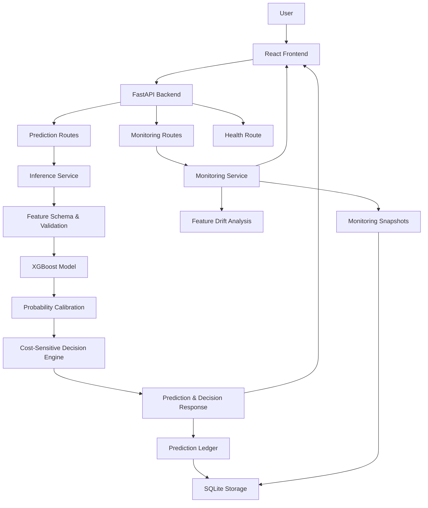

<div align="center">

# DriftSentinel

### Temporal Fraud Intelligence & Adaptive Decision Platform

**A research-driven fraud detection platform combining temporal machine learning, probability calibration, cost-sensitive decision-making, and continuous monitoring.**

[](https://www.python.org/)
[](https://fastapi.tiangolo.com/)
[](https://react.dev/)
[](https://vite.dev/)
[](https://xgboost.readthedocs.io/)
[](https://scikit-learn.org/)

</div>

---

## Table of Contents

- [Overview](#overview)
- [Problem Statement](#problem-statement)
- [Key Features](#key-features)
- [System Architecture](#system-architecture)
- [How It Works](#how-it-works)
- [Machine Learning Pipeline](#machine-learning-pipeline)
- [Decision Intelligence](#decision-intelligence)
- [Monitoring and Drift Detection](#monitoring-and-drift-detection)
- [Research and Experimental Methodology](#research-and-experimental-methodology)
- [Technology Stack](#technology-stack)
- [Repository Structure](#repository-structure)
- [Getting Started](#getting-started)
- [Running the Application](#running-the-application)
- [API Documentation](#api-documentation)
- [Testing](#testing)
- [Research Documentation](#research-documentation)
- [Evaluation and Project Status](#evaluation-and-project-status)
- [Limitations](#limitations)
- [Future Improvements](#future-improvements)

---

## Overview

DriftSentinel is a temporal fraud intelligence and adaptive decision platform designed to investigate and address important challenges in machine learning-based fraud detection.

Traditional fraud detection systems often focus primarily on classification performance. However, real-world fraud environments are dynamic: transaction patterns change, probability estimates can become unreliable, and decision policies must account for operational costs and limited review capacity.

DriftSentinel approaches fraud detection as a broader decision-making problem rather than treating it as a standalone binary classification task.

The platform integrates:

- Machine learning-based fraud prediction.
- Probability calibration.
- Cost-sensitive decision policies.
- Review-capacity-aware decision-making.
- Temporal model evaluation.
- Feature distribution monitoring.
- Prediction history and monitoring persistence.
- An API-backed web application for interacting with model outputs and monitoring information.

The project combines a research-oriented experimentation pipeline with an application designed to expose and inspect fraud intelligence outputs.

## Problem Statement

Fraud detection presents several interconnected challenges:

1. **Temporal variation:** Transaction distributions and fraud patterns may change over time.
2. **Probability reliability:** A model's predicted probability is not necessarily a reliable estimate of actual fraud likelihood.
3. **Unequal decision costs:** False approvals, unnecessary blocks, and manual reviews have different operational consequences.
4. **Limited review capacity:** Sending every suspicious transaction for manual investigation is not operationally feasible.
5. **Monitoring requirements:** Changes in incoming transaction distributions need to be identified and investigated.

DriftSentinel investigates these challenges through temporal experiments, calibration strategies, decision policies, and monitoring mechanisms.

## Key Features

### Fraud Prediction
- XGBoost-based fraud inference.
- Structured feature validation.
- A defined 431-feature model input schema.
- Separation of transaction identifiers and target labels from model predictors.

### Probability Calibration
- Probability calibration using supported calibration strategies.
- Isotonic regression and logistic regression calibration components.
- Calibration evaluation and diagnostic analysis.
- Comparison of calibration behavior across temporal evaluation windows.

### Cost-Sensitive Decision Engine
- Approve, review, and block decisions.
- Explicit decision cost configuration.
- Expected-cost-based decision selection.
- Review-capacity constraints and sensitivity analysis.

### Temporal Experimentation
- Chronological data splitting.
- Rolling-origin evaluation.
- Frozen, recent-only, retrained, and matched-size model comparisons.
- Temporal calibration experiments.
- Bootstrap-based uncertainty analysis.

### Monitoring
- Feature distribution monitoring.
- Population Stability Index (PSI) analysis.
- Prediction history.
- Batch prediction history.
- Persistent monitoring snapshots.
- SQLite-backed monitoring storage.

### Web Application
- React-based frontend.
- API-backed prediction workflows.
- Model analytics and risk analysis.
- Transaction history.
- Monitoring views.
- Interactive charts and visualizations.

---

## System Architecture

DriftSentinel follows a modular architecture separating the frontend, API, inference services, decision policies, and monitoring components.



### Architecture Components

| Component | Responsibility |
|---|---|
| React frontend | User interface, analytics, charts, and transaction inspection |
| FastAPI backend | HTTP endpoints and application orchestration |
| Inference service | Feature validation and model prediction |
| XGBoost model | Fraud probability estimation |
| Calibration module | Probability adjustment and reliability |
| Decision engine | Expected-cost-based transaction decisions |
| Monitoring service | Prediction and feature monitoring |
| SQLite storage | Persistent prediction and monitoring records |

The frontend communicates with the backend through API requests. The backend coordinates inference, decision-making, and monitoring operations.

---

## How It Works

The primary prediction workflow follows these stages:

**1. Transaction Input**

A transaction is submitted through the application or prediction API.

**2. Feature Validation**

The inference service validates the incoming transaction against the expected feature schema.

**3. Fraud Probability Estimation**

The trained XGBoost model generates a fraud probability.

**4. Probability Calibration**

The calibration component adjusts the model probability using the configured calibration artifact.

**5. Decision Evaluation**

The decision engine evaluates the calibrated probability against the configured decision costs and operational constraints.

**6. Decision Generation**

The system returns an action:

- Approve
- Review
- Block

**7. Prediction Persistence**

Prediction metadata and relevant decision information are recorded in the prediction ledger.

**8. Monitoring**

Prediction history and aggregate monitoring information are made available for further inspection.

---

## Machine Learning Pipeline

### Model Input Schema

The production inference pipeline uses a defined feature schema containing 431 model input features:

| Feature Category | Count |
|---|---:|
| Numerical features | 392 |
| Categorical features | 39 |
| Total | 431 |

`TransactionID` and `isFraud` are not model predictors.

Transaction identifiers may be retained as prediction metadata, while raw transaction feature vectors are not stored in the prediction ledger.

### Model Development

The project includes baseline and XGBoost model implementations, feature preprocessing, temporal data splitting, and model evaluation components.

The primary application inference pipeline uses:

- XGBoost for fraud probability estimation.
- Scikit-learn preprocessing components.
- Probability calibration.
- A configurable decision policy.

### Probability Calibration

Calibration is important because fraud decisions depend not only on ranking transactions but also on the reliability of predicted probabilities.

The project includes calibration methods and diagnostic components for evaluating probability reliability.

Calibration analysis considers:

- Reliability diagrams.
- Calibration error diagnostics.
- Temporal calibration behavior.
- Comparisons between calibration strategies.

---

## Decision Intelligence

DriftSentinel treats fraud detection as a cost-sensitive decision problem.

Instead of relying exclusively on a fixed classification threshold, the decision engine evaluates the expected costs associated with available actions.

### Supported Decisions

| Action | Description |
|---|---|
| Approve | Allow a transaction to proceed |
| Review | Send a transaction for additional investigation |
| Block | Reject a transaction |

### Cost-Sensitive Decision-Making

The system considers the configured costs associated with different decision outcomes.

The decision engine supports:

- Explicit decision cost configuration.
- Expected-cost evaluation.
- Threshold analysis.
- Review-capacity constraints.
- Capacity sensitivity experiments.

The cost values are illustrative policy units, not monetary amounts.

The purpose is to investigate how decision policies affect operational outcomes under different cost assumptions and review constraints.

---

## Monitoring and Drift Detection

DriftSentinel includes monitoring components designed to inspect changes in transaction feature distributions and maintain prediction-related records.

### Feature Drift

Population Stability Index (PSI) is used as a distribution-shift screening indicator.

The monitoring implementation supports:

- Reference profile generation.
- Feature-level distribution comparisons.
- PSI-based drift screening.
- Aggregate monitoring snapshots.

PSI indicates changes in distributions. It does not independently establish model degradation or concept drift.

### Prediction Monitoring

The platform records prediction-related information and maintains historical records for inspection.

The monitoring layer includes:

- Prediction ledger storage.
- Batch history.
- Monitoring snapshot storage.
- SQLite persistence.
- Monitoring service orchestration.

Raw transaction feature vectors are not stored in the prediction ledger.

### Monitoring Limitations

The monitoring snapshots available in the research/demo environment are validation backtests, not evidence of live production traffic.

Performance degradation and concept drift require reliable ground-truth labels, which may become available only after predictions have been generated.

---

## Research and Experimental Methodology

A significant part of DriftSentinel focuses on investigating fraud detection under temporal variation.

The experimentation pipeline includes the following areas.

### Temporal Evaluation

- Chronological dataset splitting.
- Rolling-origin evaluation.
- Temporal window analysis.
- Out-of-time evaluation.

### Model Comparisons

The research includes comparisons involving:

- Frozen models.
- Recent-only training strategies.
- Retrained models.
- Matched-size model comparisons.

These comparisons investigate the effect of training data selection and temporal composition.

### Calibration Experiments

- Static calibration.
- Adaptive calibration strategies.
- Rolling-origin calibration evaluation.
- Calibration reliability diagnostics.

### Decision Policy Experiments

- Cost-sensitive threshold analysis.
- Static versus adaptive strategy comparisons.
- Review-capacity sensitivity.
- Cost sensitivity analysis.

### Statistical Analysis

- Paired bootstrap analysis.
- Temporal block bootstrap.
- Confidence interval estimation.
- Paired difference analysis.

These experiments are intended to provide a more comprehensive evaluation than relying on a single classification metric.

Detailed methodology and experimental findings are maintained separately in the documentation directory.

---

## Technology Stack

### Backend and Machine Learning

| Technology | Purpose |
|---|---|
| Python | Primary programming language |
| FastAPI | REST API framework |
| NumPy | Numerical computation |
| Pandas | Data manipulation |
| Scikit-learn | Preprocessing, calibration, and evaluation |
| XGBoost | Fraud classification |
| SciPy | Statistical analysis |
| PyArrow | Parquet data processing |
| Pydantic | Request and data validation |
| SQLite | Persistent monitoring storage |

### Frontend

| Technology | Purpose |
|---|---|
| React 19 | User interface |
| Vite | Development server and build tooling |
| Tailwind CSS 4 | Styling |
| React Router | Client-side routing |
| Recharts | Data visualization |
| Lucide React | Icons |
| PapaParse | CSV processing |

### Development and Testing

| Technology | Purpose |
|---|---|
| Pytest | Python testing |
| Ruff | Python linting |
| Oxlint | Frontend linting |
| Jupyter | Research experimentation |
| Git and GitHub | Version control |

---

## Repository Structure

```text
DriftSentinel/
│
├── src/
│   └── driftsentinel/
│       ├── api/
│       │   ├── routes/
│       │   ├── schemas/
│       │   └── main.py
│       │
│       ├── calibration/
│       ├── data/
│       ├── experiments/
│       ├── features/
│       ├── models/
│       ├── monitoring/
│       └── policies/
│
├── frontend/
│   ├── src/
│   ├── public/
│   ├── package.json
│   └── vite.config.js
│
├── scripts/
│   ├── data preparation scripts
│   ├── model training scripts
│   ├── evaluation scripts
│   ├── calibration experiments
│   └── monitoring analysis scripts
│
├── tests/
│   ├── api/
│   └── unit/
│
├── configs/
│   └── data.yaml
│
├── data/
│   └── datasets and processed partitions
│
├── artifacts/
│   ├── model artifacts
│   └── runtime artifacts
│
├── experiments/
│   └── results/
│
├── notebooks/
│
├── paper/
│   ├── main.tex
│   ├── references.bib
│   └── figures/
│
├── docs/
│   ├── research_reproduction.md
│   ├── temporal_experiment_findings.md
│   └── model_artifact_manifest.json
│
├── pyproject.toml
├── README.md
└── .gitignore
```

The tree describes the major project components. Some generated files, datasets, and local runtime artifacts may be excluded from version control.

---

## Getting Started

### Prerequisites

Install the following before running the project:

| Requirement | Version |
|---|---|
| Python | 3.11 or 3.12 |
| Node.js | Compatible with Vite 8 |
| npm | Compatible with your Node.js installation |
| Git | Recent version |

The backend and frontend are installed separately.

### 1. Clone the Repository

```powershell
git clone <YOUR_GITHUB_REPOSITORY_URL>
cd DriftSentinel
```

Replace the placeholder with your actual GitHub repository URL.

### 2. Create a Python Environment

```powershell
py -3.11 -m venv .venv
```

Activate the environment:

```powershell
.\.venv\Scripts\Activate.ps1
```

If PowerShell blocks script execution, use:

```powershell
Set-ExecutionPolicy -Scope Process -ExecutionPolicy Bypass
.\.venv\Scripts\Activate.ps1
```

### 3. Install Python Dependencies

Install the project with its development and API dependencies:

```powershell
python -m pip install --upgrade pip

pip install -e ".[dev,api]"
```

The project uses `pyproject.toml` as its dependency and package configuration.

### 4. Install Frontend Dependencies

Open a separate terminal:

```powershell
cd frontend

npm install
```

---

## Running the Application

The backend and frontend should run in separate terminal sessions.

### Start the Backend

From the repository root, with the Python environment activated:

```powershell
python -m uvicorn driftsentinel.api.main:app --reload
```

The backend will be available at:

```text
http://127.0.0.1:8000
```

The API loads its required model and monitoring reference artifacts from the `artifacts/` directory.

The SQLite monitoring database is created locally at:

```text
artifacts/monitoring/monitoring.db
```

This is the default database location in the current application configuration.

### Start the Frontend

Open another terminal:

```powershell
cd frontend

npm run dev
```

Vite starts the frontend development server and provides a local URL in the terminal.

The frontend uses the configured Vite proxy to forward `/api` requests to:

```text
http://127.0.0.1:8000
```

This allows the frontend to communicate with the backend during local development.

---

## API Documentation

DriftSentinel exposes its application functionality through FastAPI routes.

The API includes the following route groups:

| Route Group | Purpose |
|---|---|
| Health | Application health checks |
| Prediction | Transaction prediction and prediction history |
| Monitoring | Monitoring snapshots and monitoring operations |

FastAPI automatically generates interactive API documentation.

Once the backend is running, open:

**Swagger UI**

http://127.0.0.1:8000/docs

**ReDoc**

http://127.0.0.1:8000/redoc

These interfaces provide the registered endpoint paths, request schemas, response models, and interactive API testing.

---

## Testing

DriftSentinel includes unit tests and API integration tests.

### Install Testing Dependencies

From the repository root:

```powershell
pip install -e ".[dev,api]"
```

### Run the Complete Test Suite

```powershell
python -m pytest -q
```

### Run API Tests

```powershell
python -m pytest tests/api -v
```

### Run Unit Tests

```powershell
python -m pytest tests/unit -v
```

### Run Python Linting

```powershell
ruff check src scripts tests
```

Test results should be checked in the environment in which the project is being evaluated.

---

## Research Documentation

The research and methodology documentation is maintained separately from the main application code.

| Document | Description |
|---|---|
| [Research Reproduction Guide](docs/research_reproduction.md) | Experiment methodology and reproduction instructions |
| [Temporal Experiment Findings](docs/temporal_experiment_findings.md) | Consolidated temporal experiment findings |
| [Model Artifact Manifest](docs/model_artifact_manifest.json) | Model artifact metadata |

The research paper and supporting figures are maintained in `paper/`.

The `experiments/results/` directory contains generated evaluation outputs, diagnostic results, and experimental summaries.

Refer to the reproduction guide for dataset requirements, experiment execution details, and artifact dependencies.

---

## Evaluation and Project Status

The project includes a final chronological holdout evaluation involving **88,580 transactions**.

The evaluation follows a separation between model development and final performance assessment:

- Model training and development were conducted separately from the final holdout evaluation.
- The final holdout labels were not used for model training.
- Calibration fitting, threshold selection, and model selection were completed without using final holdout labels.
- Predictions were frozen before the separate evaluation stage accessed the holdout labels for metric calculation.
- No model retraining or calibrator refitting occurred during the final evaluation.

The research also includes temporal comparisons, calibration diagnostics, cost analysis, capacity sensitivity, and bootstrap uncertainty analysis.

These results are research evaluation outputs and should not be interpreted as evidence of deployment in a live banking or payment environment.

---

## Limitations

DriftSentinel is a research and demonstration platform. Its current implementation has several important limitations.

1. **Dataset dependency:** Model behavior and experimental conclusions depend on the dataset and its temporal characteristics.
2. **Temporal drift:** A detected feature distribution shift does not necessarily indicate declining model performance.
3. **Ground-truth availability:** Reliable concept drift and performance monitoring require ground-truth labels.
4. **Illustrative costs:** Decision cost values represent configurable policy units rather than validated real-world financial costs.
5. **Validation backtests:** Existing monitoring snapshots are validation backtests, not live production monitoring records.
6. **Deployment scope:** The application should not be treated as a production-ready financial fraud prevention service without further security, reliability, operational, and domain validation.

---

## Future Improvements

Potential directions for further development include:

- Automated monitoring alerts.
- More extensive drift monitoring and diagnostics.
- Delayed-label performance evaluation.
- More robust adaptive calibration strategies.
- Model and calibration artifact versioning.
- Expanded API authentication and authorization.
- Production-oriented deployment and observability.
- Further evaluation on additional datasets and temporal environments.

---

## Acknowledgements

DriftSentinel brings together machine learning, statistical evaluation, temporal experimentation, and application engineering to investigate the challenges of maintaining reliable fraud detection systems over time.

The project is intended to support further experimentation and discussion around temporal fraud detection, calibrated probabilities, cost-sensitive decisions, and model monitoring.

---

<div align="center">

**DriftSentinel**

*Making fraud intelligence more temporally aware, measurable, and decision-oriented.*

</div>
